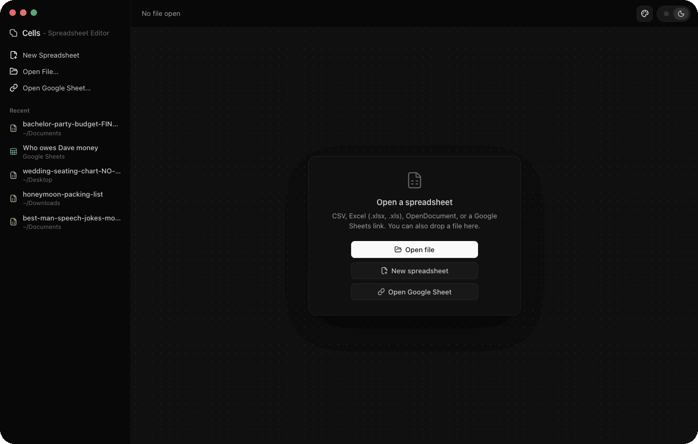

<picture>
  <source media="(prefers-color-scheme: dark)" srcset="docs/title-dark.png">
  
</picture>

Cells is a quick, lightweight, open-source spreadsheet editor for macOS. Open and edit CSV files, Excel workbooks and Google Sheets, with more than 300 Excel functions, cell formatting, sorting, filtering and multiple sheets.



It is built with [Tauri 2](https://tauri.app): a Rust backend with the [IronCalc](https://www.ironcalc.com) spreadsheet engine, and a React frontend for the interface. The app is about 14 MB, 7 MB as a download.

## Why Cells

- **Fast and native.** A real macOS app built in Rust, about 14 MB, that opens spreadsheets instantly. No Electron and no bundled browser.
- **Free and open source.** No account, no subscription and no telemetry. MIT licensed.
- **Opens what you already have.** CSV and TSV, Excel (`.xlsx`, `.xlsm`, `.xls`, `.xlsb`), OpenDocument (`.ods`) and Google Sheets links.
- **Real formulas.** More than 300 Excel functions, calculated as you type, using the IronCalc engine.
- **Keeps your files intact.** Filters, pictures, charts, comments and tables are kept when you save an Excel file.

## Features

**Opening files**

- CSV, TSV and text files, Excel `.xlsx` and `.xlsm`, Excel 97-2003 `.xls`, Excel binary `.xlsb` and OpenDocument `.ods`.
- Google Sheets: paste a share link ("Anyone with the link can view"), or open a `.gsheet` file from Google Drive for desktop. All tabs are downloaded.
- Open from Finder (Open With, double-click), by dropping a file on the window, or from the Recent panel. A file opened from Finder while Cells is closed opens as soon as Cells starts.
- `.xls`, `.xlsb` and `.ods` open with their values; Save As writes them as `.xlsx` or CSV.

**Formulas**

- More than 300 Excel functions, calculated as you type.
- References follow when rows and columns are inserted, deleted or moved.
- While typing a formula, click or drag over cells to insert their reference.
- The formula bar shows the formula of the selected cell. Type a cell address like `B12` in the address box to go there.

**Formatting**

- Bold, italic, underline, strikethrough, font size, text color and fill color.
- Horizontal and vertical alignment, wrapped text, borders (all, outside, inside, single sides; thin, medium, thick, dashed, dotted, double).
- Number formats: number, whole number, percent, currency (kr, $, €), scientific, dates, date and time, time and text, with buttons for more or fewer decimals.
- Merge and unmerge cells, clear formatting.

**Rows, columns and sheets**

- Insert, delete, move, hide and show rows and columns. Drag to resize; double-click a column edge to fit its contents.
- Freeze rows and columns. The Header row checkbox keeps the first row in place when scrolling, sorting and filtering.
- Add, rename, duplicate, delete, reorder and hide sheets.

**Editing**

- Fill handle: drag the corner of a selection to continue numbers, dates and formulas. Fill down (⌘D) and fill right (⌘R).
- Copy, cut and paste. Within Cells, pasting keeps formulas and formatting; text from other apps is pasted as values, and one value pasted on a selection fills it.
- Find and replace, with match case and whole cell.
- Sort by one or more columns, filter rows by text or by column values. Sorting and filtering change what is shown, not the order in the file.
- Undo and redo for every change.
- The status bar shows count, sum, average, minimum and maximum of the selection.

**Saving**

- CSV keeps its separator, text encoding (UTF-8 with or without byte order mark, UTF-16, Windows-1252), line endings and decimal commas. Postal codes like `0150` and long numbers like barcodes stay text. An unchanged file saves back byte for byte.
- Excel files keep what the engine does not model: filters, pictures, charts, comments, data validation lists, tables, sheet protection and print settings are copied from the original file when saving.
- A notice says when a file has parts Cells does not keep (pivot tables, slicers, links to other workbooks, macros), and when formulas give a different result in Cells than the one stored in the file.
- The first save of a session moves the original file to the Trash instead of overwriting it.

**Interface**

- The same design as [Lookout](https://github.com/lakiAlex/lookout): a title bar across the window, an icon sidebar, a side panel and the sheet on a rounded surface. Icons are [Hugeicons](https://hugeicons.com).
- The title bar shows the open file with its format and folder, and a dot when it has unsaved changes. Save As, Save, the window layout button and the light and dark switch are on the right.
- The sidebar has Recent files, Find and replace, New spreadsheet, Open file and Open Google Sheet. It minimizes to a narrow strip with small icons.
- The Recent panel lists recent files with an icon per format (Excel, CSV, OpenDocument, Google Sheets) and a filter box. It opens and closes with ⇧⌘E and can be resized by dragging its edge. Right-click a file to show it in Finder or remove it from the list.
- Without an open file, a start screen has Open, New, Open Google Sheet and the most recent files.
- The window layout button opens a panel with four layouts, as in the Rectangle app: left half, right half, center and fill the screen. Clicking left or right again steps the width through 1/2, 2/3 and 1/3, clicking center again makes the window larger, and clicking fill again puts the window back where it was.
- The ... button at the bottom of the sidebar has light and dark mode, the accent color (Neutral, white in dark mode and black in light mode, or one of the macOS system colors) and memes.
- The cat button in the corner shows a random meme from Reddit through [meme-api.com](https://github.com/D3vd/Meme_Api), skipping posts marked NSFW. Settings > Memes turns it off.

## Keyboard shortcuts

| Keys | Action |
| --- | --- |
| ⌘N, ⌘O | New spreadsheet, open file |
| ⌘S, ⇧⌘S | Save, Save As |
| ⌘Z, ⇧⌘Z | Undo, redo |
| ⌘C, ⌘X, ⌘V | Copy, cut, paste |
| ⌘B, ⌘I, ⌘U, ⇧⌘X | Bold, italic, underline, strikethrough |
| ⌘D, ⌘R | Fill down, fill right |
| ⌘F | Find and replace |
| ⇧⌘E | Show or hide the Recent panel |
| ⌘A | Select all |
| Return or F2 | Edit the cell |
| ⌥Return | Line break inside a cell |
| ⌘ and an arrow key | Jump to the edge of the data |
| Delete | Clear the selected cells |

## Install

With Homebrew:

```sh
brew install --cask lakialex/tap/cells
```

Or download `Cells_<version>_aarch64.dmg` from [Releases](../../releases), open it, and drag `Cells` into the Applications folder. The build is for Apple Silicon Macs and needs macOS 11 or later. A `.app.zip` is attached too.

The app is not signed with an Apple Developer certificate or notarized, so the first time you open a download macOS says it cannot be verified. Either right-click the app and choose Open, then confirm once, or run:

```sh
xattr -dr com.apple.quarantine /Applications/Cells.app
```

The Homebrew cask does this for you.

## Build from source

Requirements: [Rust](https://rustup.rs) (stable), Node.js 20 or later, and [pnpm](https://pnpm.io).

```sh
pnpm install
pnpm tauri dev                  # run in development mode
pnpm tauri build                # build Cells.app and the .dmg in src-tauri/target/release/bundle/
```

## Tests

```sh
cd src-tauri
cargo test
```

`scripts/corpus/` checks Cells against about 2,300 real spreadsheet and CSV files from the test collections of calamine, XlsxWriter, Apache POI, IronCalc and csv-spectrum: opening, rendering, calculated values against the values stored in the files, saving, and the editing commands. Its README has the steps.

## Spreadsheet engine

Formulas, formatting and `.xlsx` reading and writing use IronCalc 0.9.1. A copy is in `src-tauri/vendor/ironcalc_base` with fixes for problems the file check found: functions over whole columns (`VLOOKUP(x, A:B, 2)`, `MATCH`, `MAX`) took seconds per recalculation, the Student's t functions hung with very large inputs, and `BETA.INV` crashed with some inputs. [`vendor/PATCHES.md`](src-tauri/vendor/PATCHES.md) lists every change.

IronCalc does not support everything Excel does. Some table references (`[Column]` inside a table's total row), links to other workbooks and references across several sheets (`Sheet1:Sheet3!A1`) give an error in Cells. When an opened file has formulas like these, the notice above the grid says how many give a different result than the one stored in the file.

## Project layout

| Path | Contents |
| --- | --- |
| `src-tauri/src/document.rs` | An open spreadsheet: loading, editing commands, undo, saving |
| `src-tauri/src/view.rs` | Sort and filter |
| `src-tauri/src/book.rs` | CSV and value-only formats into the engine and back, recalculation check |
| `src-tauri/src/formats/` | CSV, `.xls`/`.xlsb`/`.ods` reading, `.xlsx` repair and cleanup, keeping parts on save (`carry.rs`) |
| `src-tauri/src/google.rs` | Google Sheets download |
| `src-tauri/src/corpus.rs` | Checks for the file collection |
| `src-tauri/vendor/` | Patched IronCalc engine |
| `src/components/Grid.tsx` | The grid: drawing, selection, editing, fill handle, frozen panes |
| `src/components/Sidebar.tsx` | Sidebar icons and the Recent panel |
| `src/components/WindowSnap.tsx` | The window layout button, shared with Lookout and Dispatch |
| `src/components/` | Toolbar, dialogs, sheet tabs, find bar, filters, menus |
| `src-tauri/icons/` | App icon. `build-icon.sh` rebuilds the macOS 26 icon. |

## Data

- Recent files: `~/Library/Application Support/com.laki.cells/recent.json`
- Light or dark mode, the accent color, the sidebar and panel state and the memes setting are stored by the app's web view.

## Third-party software

| Component | Used for | License |
| --- | --- | --- |
| [IronCalc](https://github.com/ironcalc/IronCalc) | Spreadsheet engine, `.xlsx` reading and writing | MIT or Apache-2.0 |
| [calamine](https://github.com/tafia/calamine) | Reading `.xls`, `.xlsb` and `.ods` | MIT |
| [csv](https://github.com/BurntSushi/rust-csv) | Reading and writing CSV | MIT or Unlicense |
| [encoding_rs](https://github.com/hsivonen/encoding_rs) | Text encodings | MIT or Apache-2.0, and BSD-3-Clause |
| [Tauri](https://tauri.app) | App framework | MIT or Apache-2.0 |
| [React](https://react.dev) | Interface | MIT |
| [Hugeicons](https://hugeicons.com) | Icons | MIT |
| [Lucide](https://lucide.dev) | The title bar glyph | ISC |

[THIRD_PARTY_NOTICES.md](THIRD_PARTY_NOTICES.md) has more detail.

## FAQ

**Is Cells free?** Yes. It is free and open source under the MIT license, with no account, subscription or telemetry.

**Can it open Excel files?** Yes, `.xlsx`, `.xlsm`, `.xls` and `.xlsb`, with formulas, formatting and more than 300 Excel functions.

**Can it open CSV and Google Sheets?** Yes. It opens CSV and TSV files, and Google Sheets from a share link or a `.gsheet` file.

**Does it work offline?** Yes, apart from downloading a Google Sheet, which needs a connection.

**Does it work on Apple Silicon and Intel Macs?** The prebuilt download is for Apple Silicon (M1 and later), macOS 11 or later. On an Intel Mac you can build it from source.

**Is it an Excel or Google Sheets alternative?** It is a lightweight, native spreadsheet editor for macOS that opens those files directly, for quick viewing and editing without a heavy office suite or a browser tab.

## License

Cells is released under the [MIT License](LICENSE).
